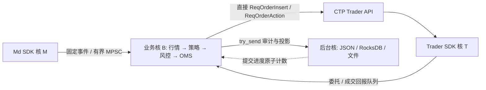

# CTP 单业务核固定布局

最后更新：2026-11-13

本布局用于行情驱动交易的同进程接入接口。策略规则尚未配置，默认 `NoStrategy` 不产生订单。**当前开发机和所有内网机器禁止执行 CTP**，包括配置检查程序、离线 SDK、测试、探针和基准；本轮仅编辑和编译。运行限制见 [AGENTS.md](../AGENTS.md#ctp-execution-location-restriction)。

## 固定四个物理核

| 域 | 示例 CPU ID | 固定职责 |
| --- | ---: | --- |
| 业务 B | 0 | 消费行情与委托/成交回报、策略回调、风控、OMS、报撤单 SDK 调用 |
| Trader SDK T | 1 | Trader SDK 内部网络与回报工作线程 |
| Md SDK M | 2 | Md SDK 内部网络与行情回调工作线程 |
| 后台 I/O | 3 | Journal、JSON/脱敏、RocksDB WAL/flush/compaction、stdin 读取、可选持仓 IPC 编码/发送 |

四个域在同一允许使用的 NUMA 节点，每个域一个逻辑 CPU，且四个 CPU 必须来自不同物理核。示例 ID 不是实际部署分配；外部主机确定后按其拓扑填写。SMT 兄弟核不应承载其他忙任务，系统和网卡 IRQ/softirq 另留 housekeeping CPU；本实现不修改内核中断亲和性。SDK 内部线程数量由官方库决定，多个 SDK 工作线程共享本域的一个核。



行情消费和交易决策共用 B，不经过另一个行情业务线程、stdout JSON 或进程间转发。策略只借用只读 `TradingCore`，通过定长动作容器提交意图，仍由统一核心完成风控、仓位冻结、平今平昨拆分及事实成交处理。

## 配置固定关系

[交易配置](../config/ctp_trade.example.toml) 和[行情配置](../config/ctp_market_data.example.toml) 的 `business_cpu`、`background_cpus` 和 `numa_node` 必须相同，两个 `sdk_cpus` 各含一个不同的 CPU。合并验证四个域的 NUMA、允许 CPU 集合和 SMT 拓扑，失败退出，不扩核或自动回退。

```toml
# trade.toml
[placement]
numa_node = 0
business_cpu = 0
sdk_cpus = [1]
background_cpus = [3]
```

```toml
# md.toml
[placement]
numa_node = 0
business_cpu = 0
sdk_cpus = [2]
background_cpus = [3]
```

两份配置使用相同 BrokerID 和凭据变量名，分别使用独立 flow 目录。每个交易白名单合约必须显式订阅行情；额外的订阅可供策略观察，不能因此取得报新单权限。单独运行只读 `ctp-md` 仍使用三个域；上述配对文件供同一个 `ctp-trader` 进程使用，不用于同时启动两个独立业务循环。

## 业务循环不等待持久化

CTP 的 `sync_before_send`、`idle_sleep_us` 和交易端 `reconnect_backoff_ms` 配置已移除；旧配置带这些字段会被拒绝，需删除。业务循环固定忙轮询。报撤单审计、原始回报、订单/成交投影和策略执行回执均使用有界队列 `try_send`，不等待写盘或消费者。队列满、断开及写盘失败显式终止交易，不丢弃后继续报单，也不自动重试订单。

恢复使用异步 checkpoint：柜台完整快照通过校验后提交持久化校验，业务循环继续消费行情和回报，通过原子进度计数轮询结果。checkpoint 成功前 `core.is_ready()` 为 false，新报单和撤单被阻断；失败或 30 秒超时终止运行。成功只能解除这个等待条件，不能清除断线、结算未确认或事实冲突等其他阻断。后台 WAL 仍同步提交，业务循环没有逐笔持久化确认等待。

异步发送存在崩溃窗口：SDK 已收到请求时，审计尾部可能尚未落盘。不能同时保证“发送不等待落盘”和“每个已发送请求都已持久化”。重启继续依赖柜台完整追平和数据库未决请求校验，详见[持久化保证](cn_order_persistence.md)。

初始化时打开文件/数据库、加载与初始化 SDK，以及退出主循环后的 SDK Release 和最终刷盘属于生命周期工作，可能阻塞。恢复落盘不会阻塞正在运行的业务循环；退出后用完成状态轮询排空后台。SDK 自带传输重连保留；需要重建对象的传输/控制响应超时会输出 `restart_required` 并退出，外部监管负责重启，业务循环不做 Release/Init。

`position_ipc = { namespace = "cn_ctp_sim", interval_ms = 1000 }` 可启用与 Exec 相同思路的全量持仓观察通道。定时到期后，业务线程把今昨仓、冻结量及连接/恢复状态复制到冷初始化的三个缓冲之一，以 `try_recv` / `try_send` 替换尚未消费的旧快照；不会构造 JSON、扫描订单或等待后台。编码、1 MiB IPC 消息初始化和发送由继承后台域放置的独立线程执行。命名空间显式配置，消息绑定账户摘要、进程 epoch、序号和业务采集时间。容量为 8192 条多空持仓行，超限整帧失效，不发布部分持仓；观察发布失败不重试交易请求，Viz 最迟在心跳过期后显示不可用。该通道不替代委托/成交持久化。详见 [Viz](cn_futures_viz.md)。

CTP 的 Req 系列本身是厂商同步函数调用，不能在没有证据时保证库内部从不拿锁、触发缺页或阻塞。当前保证是应用业务路径没有阻塞式队列收发、文件 I/O、持久化确认等待或 sleep。全链路硬实时、零分配和确定的 p99 尚未获得验证。

## 策略接口

`ctp::strategy::Strategy` 提供 `on_tick`、`on_update`、`on_market_state` 和 `on_result`。回调在 B 上顺序执行；实现必须只做有界 CPU 计算，不能进行网络/文件 I/O、休眠、等待或无界循环。每个 tick 最多产生 8 个带 `tag` 的 Submit/Cancel 动作，超过容量返回错误，容器不会扩容。

`StrategyContext::can_trade` 同时要求显式执行权限、核心恢复完成、行情订阅就绪、回报/行情没有已知积压，以及行情 TradingDay 与交易日一致。发送前再次检查就绪、积压和故障。tick 的原始日期/时间及本机接收时间均保留；具体策略仍需按品种交易时段与时效规则判断信号，不能把刚收到的回调直接认定为实时行情。

`on_result` 返回本地发送结果和子单身份，不表示柜台接受或成交。原生委托/成交更新通过 `on_update` 到达；行情 gap/代次变化通过 `on_market_state` 通知，策略应清除旧会话信号。策略回调失败会终止业务循环，没有自动重试。

库入口为 `runtime::run_with_strategy(trade_config, Some(md_config), execute, strategy, &stop)`。现有 CLI 只传入 `NoStrategy`，所以即使附带行情配置，也不会自动生成订单；手工 JSON 指令仍由 `--execute` 控制。合并行情模式在 stdin EOF 后继续运行，可用 `shutdown` 或 SIGINT/SIGTERM 正常退出；仅交易模式保留 EOF 退出行为。

```bash
# 仅限用户指定并授权的外部主机；默认只读，无自动策略
target/release/ctp-trader --config /absolute/private/trade.toml \
  --market-data-config /absolute/private/md.toml --connect
```

本轮新增用例仅编译，没有运行 CTP、测试、SDK 或压测，也没有部署或修改主机 CPU/IRQ 设置。
